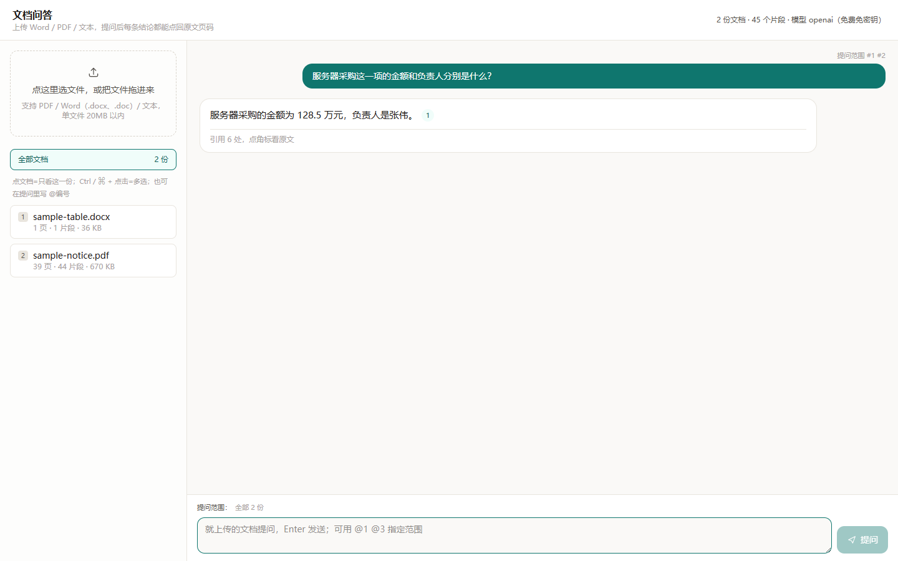

# 知简 · 智能文档分析平台

> 参赛作品 · 赛道：AI协同办公工具（智能文档分析平台方向）

上传 Word / PDF / 文本，直接提问；回答里每条结论都带来源编号，点角标就能看到那句话在原文哪一页。
面向「几份办公文档、问几个问题」的真实场景，本地一条命令跑起来，**无需任何密钥、零配置即可使用**（内置免密钥文本模型）。

## 功能特性

- **能读**：PDF（按坐标重排，不会把标题拼成乱码）、Word 新旧两种格式（`.docx` / `.doc`，含 WPS 把旧版存成 `.docx` 的情况）、纯文本 `.txt` / `.md`
- **文字位置不限**：Word 里的正文、**表格**、文本框、页眉页脚、脚注尾注、批注都会进索引
- **页码可信**：引用页码由解析层给出，不是「永远第 1 页」；点角标打开原文抽屉，命中词高亮
- **检索**：本地 BM25，不需要向量数据库、不需要额外密钥、不联网
- **回答**：只依据上传的内容作答；资料不足会直说「没有相关内容」，不编造
- **引用校验**：模型万一编出越界编号（比如只有 3 条却写 `[9]`），流式实时剔除，不留点不动的死链

## 界面预览



> 左侧上传与文档列表，右侧问答；回答里的 **[n]** 是可点角标，点开右侧抽屉看该页原文并高亮命中词。顶部显示当前模型（内置免密钥模型）。

## 演进历程

本项目不是一次写成，而是从更早的「知源 18」全功能版收敛而来：18 功能面过宽（摘要 / 纪要 / 导出 / 检索调试 / 评测 / 多会话）、且依赖额外的向量服务密钥，作为「评审零门槛跑起来」的交付形态不可行；因此抽出其中经过验证的解析内核与引用校验，重做为只做一件事的精简版，并把模型通道一路降到**免密钥**。完整决策记录见 [DEVLOG.md](DEVLOG.md)。

## 技术栈

| 层 | 选型 | 说明 |
|---|---|---|
| 前端 | Next.js 15 + React 19 + TypeScript + Tailwind CSS 4 | 单页两栏工作台，SSE 流式渲染 |
| 解析 | pdfjs-dist + 自研 OOXML 提取器 + word-extractor | 按文件头分流，不信任后缀 |
| 检索 | 自研 BM25（`lib/bm25.ts`） | 同步纯函数，单文档语料 Recall@5 实测 100% |
| 生成 | 免密钥免费模型（OpenAI 兼容接口） | 无需注册与密钥，流式输出 |
| 存储 | 进程内存 + JSON 落盘 | 重启自动恢复，无数据库 |

## 环境配置

- Node.js ≥ 20（实测 24）
- **不需要任何密钥**：内置免密钥文本模型，装完直接可用

```powershell
cd source
npm install
npm run dev            # 打开 http://localhost:3000 即可提问
```

生成接口与模型名可在 `source/.env` 里用 `FREE_BASE_URL` / `FREE_MODEL` 换成任何 OpenAI 兼容端点（默认已内置公开免密钥端点）。

生产模式：

```powershell
npm run build
npm start              # 或 node server.mjs --prod --port 3111
```

环境变量模板见 `source/.env.example`：

| 变量 | 必填 | 说明 |
|---|---|---|
| `FREE_BASE_URL` | 否 | 生成模型接口，默认内置公开的免密钥 OpenAI 兼容端点 |
| `FREE_MODEL` | 否 | 模型名，默认 `openai` |
| `DATA_DIR` | 否 | 索引落盘目录，默认 `source/.data` |

> 生成模型固定为免密钥的对话模型，页面上不提供模型切换。

## 评审快速体验

仓库自带两份示例文档（`samples/` 目录），5 分钟可跑通全流程：

```powershell
git clone https://github.com/Trek-ai/smart-doc-qa
cd smart-doc-qa\source
npm install
npm run dev                     # 打开 http://localhost:3000
```

**开箱即用，无需填任何密钥**（默认走内置免费文本模型）。直接上传 `samples\sample-table.docx`，问「服务器采购这一项的金额和负责人分别是什么？」，
回答应出现 **128.5 万元 / 张伟** 并带角标 **[1]**；点角标可看到第 1 页原文与高亮命中词。
更多推荐问题见 `samples/README.md`。

> **关于免费模型**：公开免密钥接口有频率限制（约 30 秒 1 次），首字延迟约 10 余秒，属正常现象；如需更快的响应，可在 `source/.env` 里把 `FREE_BASE_URL` / `FREE_MODEL` 换成你自己的 OpenAI 兼容端点。

## 常见问题

**Q：`npm start` 报 `Could not find a production build in the '.next' directory`？**
生产模式必须先构建：`npm run build` 之后再 `npm start`。另外 dev 与 prod **共用 `.next` 目录**，两者不要同时跑；从 dev 切到 prod 前先重新 `npm run build`。

**Q：提问后回答很慢（十几秒）？**
内置的是公开免密钥模型，有频率限制（约 30 秒 1 次）且首字较慢，属正常现象。想更快可在 `source/.env` 里换一个 OpenAI 兼容端点。

**Q：回答报频率限制之类的错误？**
等 30 秒再问一次即可。

**Q：3000 端口被占用？**
`npm run dev -- -p 3111` 换端口；或先 `taskkill /F /IM node.exe` 清掉残留进程。

## 和「直接用 DeepSeek 官网传文件问答」的区别

本系统使用免密钥模型，**不需要评审准备任何密钥**。既然「传文件问答」大模型官网也能做，这里说明本系统的不同：

| | DeepSeek 官网传文件问答 | 本系统 |
|---|---|---|
| 引用溯源 | 回答里提一句出处，**不能点回第几页核对** | 每条结论带角标，点击跳回原文页，命中词高亮 |
| 表格 / 文本框 / 页眉页脚 | 通用解析，表格内容经常丢失 | 自研 OOXML 提取器全量覆盖（实测见技术文档 5.3） |
| 乱序 PDF / 伪装后缀 | 按通用流程处理 | 坐标重排 + 文件头嗅探，专治真实办公文档的坑 |
| 防编造 | 依赖模型自觉 | 机制保证：检索无命中不调模型、越界引用实时剔除 |
| 数据隐私 | 整份文件上传云端 | 原文本机解析与索引，只有命中的少量片段发出 |
| 可扩展性 | 封闭服务 | 源码开放，可自行加 OCR、图谱检索等 |

一句话：**官网回答「文档说了什么」；本系统回答「文档说了什么、在第几页、能不能核对」**。

## 自测结果（2026-10-23，生产构建实测）

`node tmp/e2e.mjs` 四个用例全通过（真实模型）：

| 用例 | 结果 |
|---|---|
| 自建 Word（内容在**表格**里）问「服务器采购的金额和负责人」 | 答 128.5 万元 / 张伟，引用第 1 页 |
| 同一份 Word 追问合计与质保期 | 答 188.5 万元 / 24 个月，引用第 1 页 |
| 真实投稿要求 Word（WPS 存出的旧版 .doc，后缀写成 .docx） | 「每所高校最多 5 个作品」「图像 2.8%」「视频 2 秒」全中 |
| 9 页示例 PDF | 首年预算 2.52 万元引第 5 页、47 个馆引第 1/4 页 |

界面实拍（`node tmp/shot-ui.mjs`）：上传 → 问答 → 点角标看原文，无页面报错，命中词高亮 7 处；390px 移动端无横向溢出、0 外部域名请求。

## 目录结构

```
source/src/lib/parse/        解析层：pdf / ooxml(docx) / doc(旧版) / text，入口按文件头分流
source/src/lib/bm25.ts       本地 BM25 检索
source/src/lib/retrieve.ts   取前 6 个相关块
source/src/lib/verify.ts     流式引用校验
source/src/lib/prompts.ts    提示词集中管理
source/src/app/api/          ingest / docs / chat 三个接口
source/src/components/       单页工作台界面
tmp/                         自测脚本与夹具
deliverable/                 参赛材料：技术文档、演示视频
```

## 团队信息

| 姓名 | 分工 |
|---|---|
| 辛嘉炜 | 协作完成开发、技术文档与演示材料 |
| 罗勇添 | 协作完成开发、技术文档与演示材料 |
| 林俊宁 | 协作完成开发、技术文档与演示材料 |

## 许可

本项目代码仅供参赛评审使用。
